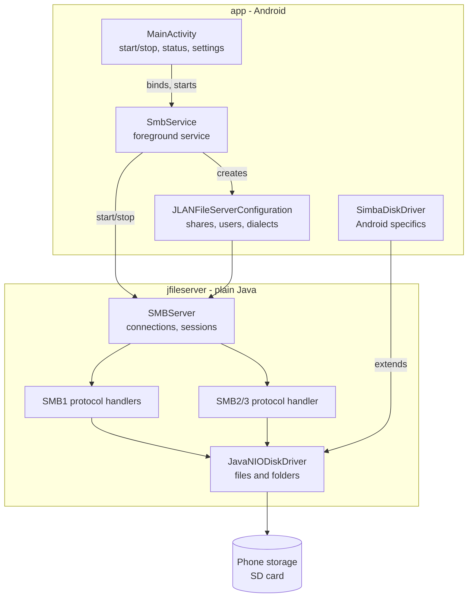

# Architecture

How SimbaDroid is put together. Start here, then follow the links for detail.

| Page | Content |
| --- | --- |
| [app.md](app.md) | The Android app: activity, service, permissions, how the server is configured and controlled. |
| [file-server.md](file-server.md) | The JFileServer library: connections, sessions, shares, the filesystem driver. |
| [smb2.md](smb2.md) | The SMB2/SMB3 implementation inside the library. |

## What the app is

An SMB file server for Android. It shares the phone's storage on the local network so that a computer can open it
like any other network drive. There is no server component of its own in the app: the protocol work is done by
JFileServer, a Java file server library, and the app's job is to configure it, keep it alive and tell the user how
to reach it.

## Modules

```
SimbaDroid/
├── app/            Android application (package de.buttercookie.simbadroid), MPL-2.0
└── jfileserver/    File server library (package org.filesys), plain Java, LGPL-3.0
```



`jfileserver` has no Android dependency. That is deliberate: it can be built and tested on a desktop JVM, which is
how the SMB2/3 code is tested (see [../code-review/verification.md](../code-review/verification.md)).

## What happens when a client connects

1. The client opens a TCP connection to port 4450 (or 445, if a rooted phone redirects it).
2. `SMBServer` accepts it and creates an `SMBSrvSession` for the connection.
3. The first message is a *negotiate*. The session picks the newest protocol dialect that both sides support and
   creates the matching protocol handler - one of the SMB1 handlers or `SMB2ProtocolHandler`.
4. The client logs on, connects to a share (`Internal`, `External` or `IPC$`) and then sends file requests.
5. The protocol handler translates each request into calls on the share's `DiskInterface`, which for this app is
   `SimbaDiskDriver`, working on the real files.

## Ports

| Port | Purpose | Reachable without root |
| --- | --- | --- |
| TCP 4450 | SMB | yes |
| TCP 1139 | SMB over NetBIOS session service | yes, but clients do not look there |
| UDP 1137, 1138 | NetBIOS name and datagram service | yes, but clients do not look there |
| UDP 5353 | mDNS: `simbadroid.local` and the `_smb._tcp` service | yes |
| TCP 445, 139, UDP 137, 138 | The standard ports, redirected to the ones above with `iptables` | root only |

## Threads

| Thread | Used for |
| --- | --- |
| Android main thread | UI and all state of `SmbService`. Starting and stopping the server. |
| App background thread (`BackgroundThread`) | Anything slow that the service needs: root shell commands, the mDNS host name broadcaster, cleaning up the trashcan folders. |
| Library: connections handler | Accepts connections. |
| Library: request handler(s) | Waits for data on the open connections. |
| Library: worker pool (6 threads) | Reads the requests and runs the protocol handlers. A connection is normally served by one worker at a time, but not strictly - which is why the handlers and the file I/O have to be thread safe. |

## Build

Gradle with two modules. The app has two flavours, `default` (Android 7+) and `oldApi` (Android 6), which differ
in how the library is configured to cope with gaps in the old Java runtime.

```
./gradlew :jfileserver:test          # server tests, no Android needed
./gradlew :app:assembleDefaultDebug  # the app
```
