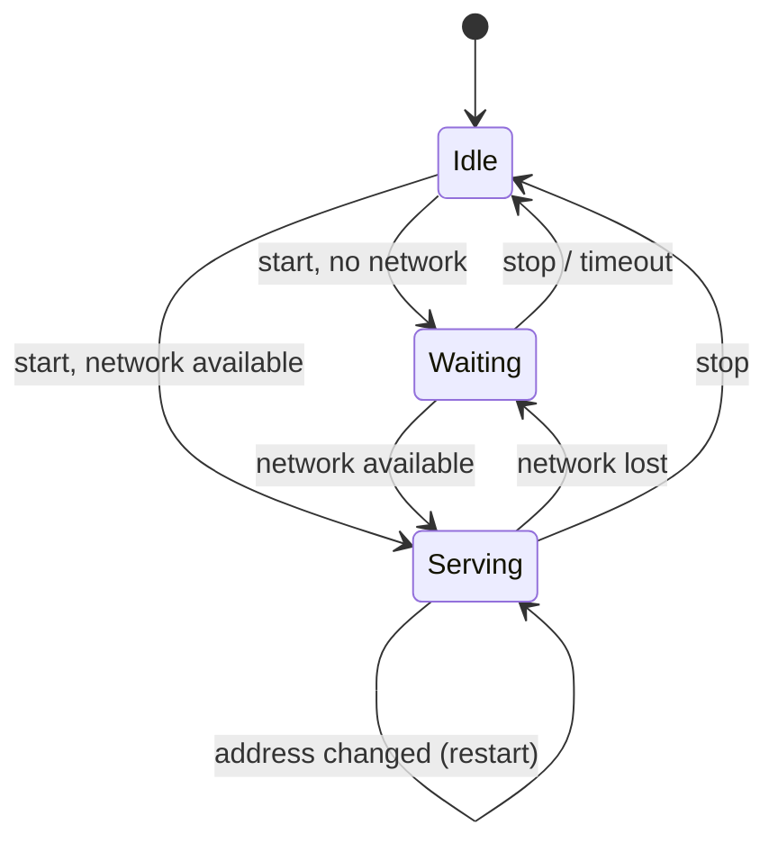

# The Android app

Package `de.buttercookie.simbadroid`, in `app/src/main/java`.

## Classes

| Class | Role |
| --- | --- |
| `Application` | Registers Bouncy Castle as a crypto provider (for the legacy algorithms of SMB1) and sets up libsu. |
| `MainActivity` | The only screen: start/stop button, status text, settings dialog. Binds to `SmbService` and observes its status. |
| `IntentReceiverActivity` | Invisible activity behind the launcher shortcut "Start server". |
| `Intents` | The intent actions for starting and stopping. |
| `service.SmbService` | Foreground service that owns the server. Everything that has to keep working while the app is not on screen lives here. |
| `service.SmbServiceStatusLiveData` | The current `SmbService.Status`, observed by the activity. |
| `service.SmbServiceConnection` | Service connection helper. |
| `service.HostnameBroadcaster` | Answers mDNS queries for `simbadroid.local` using JmDNS. |
| `jlan.JLANFileServer` | Thin wrapper to start and stop the library's servers. |
| `jlan.JLANFileServerConfiguration` | Builds the library configuration: shares, users, protocol dialects, ports, memory pool. |
| `jlan.SimbaDiskDriver`, `jlan.SimbaDiskDeviceContext` | The filesystem driver, extending the library's driver with Android specifics. |
| `settings.ServerSettings` | The user's settings (user name, password, SMB1 on/off), stored in private preferences. |
| `permissions.*` | Queue for runtime permission requests, including the "All files access" settings screen. |
| `util.Iptables` | Runs `iptables` through a root shell. |
| `util.SdCard`, `util.FileUtils` | Find the SD card; choose a trashcan folder on the same volume. |
| `util.IpSort` | Chooses the best of several IP addresses. |
| `util.ThreadUtils`, `util.BackgroundThread` | Main thread and background thread helpers. |
| `util.StyledTextUtils` | Formats string resources that contain both placeholders and markup. |

## The service

`SmbService` is a state machine with two inputs:

* **running** - the user wants the server on (start button, shortcut) or off (stop button, notification action);
* **link address** - the IPv4 address on the local network, or none.

The library servers are started when both are present and stopped when either goes away. If the server is on but
there is no network, the service waits (5 minutes after starting, 20 minutes later on) and then switches itself
off.

While running the service

* is a foreground service of type `specialUse` with a notification,
* holds a partial wake lock, a high performance Wi-Fi lock and a multicast lock,
* registers the DNS-SD service `_smb._tcp` with the port that clients can reach, and
* on rooted phones, has `iptables` rules in place that redirect the standard ports.

### Network tracking

The service requests Wi-Fi and Ethernet networks from `ConnectivityManager` and keeps a map of the connected ones
with their IPv4 address. It serves on one of them and stays there for as long as it has an address; only then does
it move to another. The process is bound to the chosen network so that the server's sockets use it even if the
network has no internet access.

### Root and ports

The server always listens on unprivileged ports (see [README.md](README.md#ports)). When it starts, the service
asks for a root shell *in the background*. If there is one, the redirect rules are added and the service notes
that the standard port works; the UI and the DNS-SD registration are then updated. Until then, and on phones
without root, clients are told to use port 4450.

### Status

All state changes end in `updateUI()`, which publishes an immutable `Status` record: whether the server is on and
reachable, the mDNS name, the IP address, the port clients must use and whether it is the standard one, and the
user name if a login is required. `MainActivity` turns that into the button state and the status text.

## Configuration of the library

`JLANFileServerConfiguration` is created each time the server is switched on:

| Section | Content |
| --- | --- |
| Core | Thread pool of 6. Memory pool with buffers of 256 B, 4 KB, 16 KB, 66 KB and 1 MB. |
| Security | Access control manager. One user account if credentials are set. |
| Filesystems | Share `Internal` for the shared storage and `External` for the SD card if there is one, both using `SimbaDiskDriver` with a trashcan folder on the same volume. |
| SMB | Server name, ports, enabled dialects (SMB2 and SMB3 always, SMB1 if allowed), authenticator. |

Authenticator: without credentials a `LocalAuthenticator` that accepts everybody (SMB1) and allows guests (SMB2/3);
with credentials a plain `LocalAuthenticator` that checks the password and refuses guests.

## The filesystem driver

`SimbaDiskDriver` extends the library's `JavaNIODiskDriver` and adds

* free space from `StatFs`,
* a workaround for an Android bug that loses a file's modification time when it is renamed on an SD card.

`SimbaDiskDeviceContext` decides whether the trashcan folder is on the same volume (by comparing device numbers)
and reports the filesystem as NTFS.

The trashcan exists because deleting a very large file can take so long that the client gives up. Such files are
moved into a hidden folder on the same volume, which is instant, and deleted from there in the background.

## Permissions

| Permission | Why |
| --- | --- |
| `MANAGE_EXTERNAL_STORAGE` (Android 11+), `WRITE_EXTERNAL_STORAGE` (older) | Access to the files that are shared. |
| `FOREGROUND_SERVICE`, `FOREGROUND_SERVICE_SPECIAL_USE`, `POST_NOTIFICATIONS` | The service and its notification. |
| `WAKE_LOCK`, `ACCESS_WIFI_STATE`, `CHANGE_WIFI_MULTICAST_STATE` | The three locks. |
| `INTERNET`, `ACCESS_NETWORK_STATE`, `CHANGE_NETWORK_STATE` | Sockets; tracking and requesting the local network. |

Root is optional and only used for the port redirect.
