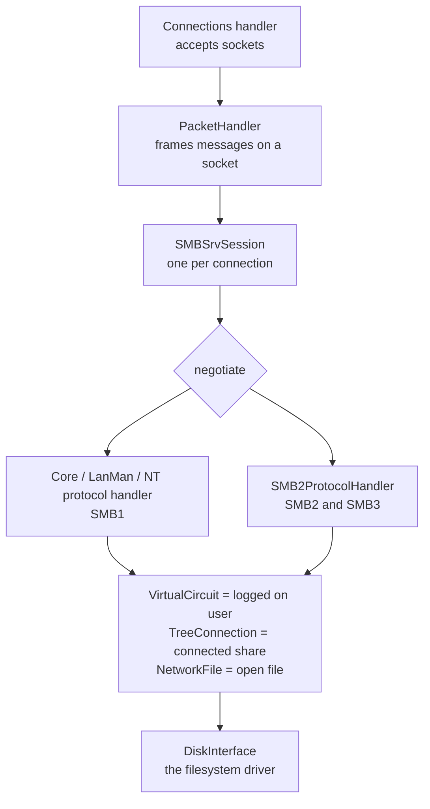

# The file server library

`jfileserver/`, package `org.filesys`. This is JFileServer (formerly Alfresco JLAN), a Java file server, with the
parts that the app does not use removed and SMB2/SMB3 added. It is licensed under the LGPL-3.0; the app is MPL-2.0.

Only the parts that matter for SimbaDroid are described here. The SMB2/SMB3 code has its own page,
[smb2.md](smb2.md).

## Layers

### Connections and packets

* `smb.server.SMBServer` owns everything for the SMB protocol. Its thread starts a connections handler and waits
  for the shutdown request.
* `smb.server.nio.NIOSMBConnectionsHandler` accepts connections using non-blocking channels and hands each new
  session to an `SMBRequestHandler`, which waits for data with a selector. When a connection has data, a worker
  from the thread pool reads the requests and processes them.
  `ThreadedSMBConnectionsHandler` is the older alternative with one thread per connection, used on Android 6.
* A `PacketHandler` knows how messages are framed on one kind of connection: `TcpipSMBChannelHandler` for SMB
  directly over TCP (4 byte length prefix), `NetBIOSSMBChannelHandler` for the NetBIOS session service.
  It also enforces the maximum request size.
* Requests are read into buffers from `SMBPacketPool`, which hands out byte arrays from a pool of fixed sizes.

### Sessions and protocol handlers

`smb.server.SMBSrvSession` represents one client connection. It starts in the *negotiate* state. The negotiate
request is parsed by an `SMBParser` (`SMBV1Parser` or `SMBV2Parser`, chosen by the first byte of the message),
the newest dialect that the client offers and the configuration allows is selected, and `ProtocolFactory` creates
the `ProtocolHandler` for it. From then on every request goes to `ProtocolHandler.runProtocol()`.

A client that offers both SMB1 and SMB2 dialects in an SMB1 negotiate is answered with an SMB2 response, after
which it sends a proper SMB2 negotiate and the handler is selected a second time.

### Users, shares and open files

These classes are shared by SMB1 and SMB2:

| Class | Meaning |
| --- | --- |
| `smb.server.VirtualCircuit` | A logged on user on a connection (an SMB1 "UID", an SMB2 "session"). Holds the `ClientInfo` and the tree connections. |
| `server.filesys.TreeConnection` | A connection to a share. Holds the open files and the access level (read only / writeable). |
| `server.filesys.NetworkFile` | An open file or folder. |
| `server.core.SharedDevice` | A share. `DiskSharedDevice` for folders, `AdminSharedDevice` for `IPC$`. |

Closing a connection closes its virtual circuits, which close their tree connections, which close their files.
That chain is also what applies "delete on close".

### Authentication

`server.auth.ISMBAuthenticator` decides who may log on and what they may do with a share. The app uses
`LocalAuthenticator`, which checks against the `UserAccountList` in the configuration.

SMB1 logons are handled by the authenticator itself (LM/NTLM challenge-response). SMB2 logons are handled by the
SMB2 code, which only asks the authenticator for the account and whether guests are allowed - see
[smb2.md](smb2.md#logon).

### The filesystem driver

`server.filesys.DiskInterface` is what a share is made of: open, create, read, write, rename, delete, list a
folder, get and set file information. Implementations take share relative paths with backslashes.

`smb.server.disk.JavaNIODiskDriver` implements it on top of `java.nio.file`:

* `JavaNIONetworkFile` wraps a `FileChannel`, opened on first use. Reads and writes are positional, so several
  requests can use one open file at the same time.
* `JavaNIOSearchContext` iterates a folder for a listing, with wildcard matching.
* `JavaNIODeviceContext` holds the per share settings: the local path, the trashcan folder, the size from which a
  file counts as "large", and whether the underlying filesystem ignores case.

Setting the end of file to a larger value does not extend the file at once; the size is applied when the file is
closed if it has not been reached by then (see finding L12 in the code review).

### `IPC$` and remote procedure calls

Clients list the shares of a server by opening the pipe `srvsvc` on the special share `IPC$` and sending a
DCE/RPC request. `smb.dcerpc.server` contains the handlers (`SrvsvcDCEHandler`, `WkssvcDCEHandler`); the protocol
handlers pass pipe data to `DCERPCHandler`.

### NetBIOS

`netbios.server.NetBIOSNameServer` answers name queries for the server name and announces the server to the
network. On an unrooted phone it listens on a port that no client asks, so it only does something useful with
root.

## Configuration

A `ServerConfiguration` holds sections - `CoreServerConfigSection` (threads, memory), `SecurityConfigSection`
(users, access control), `FilesystemsConfigSection` (shares), `SMBConfigSection` (everything SMB). The app builds
them in code (`JLANFileServerConfiguration`); the XML configuration of the original library has been removed.

`SMBConfigSection` gained three options for SMB2/3: require signing, offer encryption (on by default) and require
encryption.

## What was removed from upstream

FTP and NFS servers, database backed and cached filesystems, clustering (Hazelcast), the XML configuration and the
stand-alone application. See [../code-review/improve/library-fixes.md](../code-review/improve/library-fixes.md)
for the exact list and for the bug fixes made to the remaining code.
