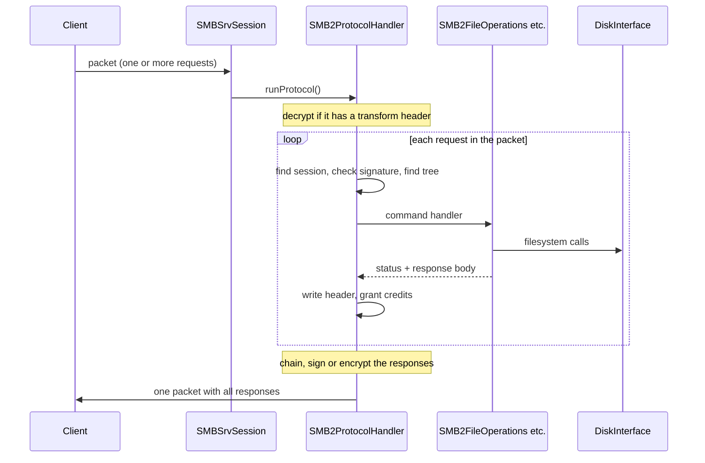

# SMB2 and SMB3

`jfileserver/src/main/java/org/filesys/smb/server/smb2/`. Implements SMB 2.0.2, 2.1, 3.0, 3.0.2 and 3.1.1 as
specified in [MS-SMB2], on top of the session, share and filesystem classes described in
[file-server.md](file-server.md).

## Classes

| Class | Role |
| --- | --- |
| `SMB2` | Constants: commands, flags, status codes, information classes. |
| `SMBV2Parser`, `SMB2NegotiateContext` | The pieces the protocol independent session code needs: recognising the packet, parsing the negotiate request, building early error responses. |
| `SMB2ProtocolHandler` | One per connection. Negotiation, request framing, credits, signing, encryption, sessions, tree connects, asynchronous requests. Dispatches the file commands to the three classes below. |
| `SMB2FileOperations` | Create, close, flush, read, write, lock. |
| `SMB2InfoOperations` | Query directory, query information, set information (including rename and delete). |
| `SMB2IoctlOperations` | IOCTL, and named pipes for DCE/RPC. |
| `SMB2InfoPacker` | Writes the file information structures. |
| `SMB2Request` | One request in a received packet, with bounds checked accessors. |
| `SMB2Buf` | Growable little-endian buffer that responses are built in. |
| `SMB2Session`, `SMB2Open` | State of a logged on user and of an open file. |
| `SMB2Exception` | Carries an NT status code out of a command handler. |
| `SMB2Authenticator`, `SPNEGOToken`, `NTLMSSPServer` | Logon. |
| `SMB2Crypto` | Key derivation, signing, encryption. |
| `SMB2LockManager` | Byte range locks. |

## Life of a request



Points worth knowing:

* **Responses are built in a new buffer**, not in the request buffer. A command handler appends its response body
  to an `SMB2Buf` and returns a status. If it throws `SMB2Exception`, or returns an error status, whatever it
  wrote is discarded and the standard error body is sent instead.
* **Compounded requests.** A packet can hold several requests. A "related" request uses the session, tree and file
  of the request before it; the `Chain` object carries these along. If the create at the start of a chain fails,
  the requests that depend on it fail with the same status.
* **Credits.** Each response grants what the client asked for, limited so that a connection never holds more than
  8192.
* **Bounds.** `SMB2Request.checkBody()` and `checkRange()` validate every structure size, offset and length before
  it is used. Nothing reads the request buffer without going through them.
* **Unexpected exceptions** from a command handler become an error response for that request; the connection
  stays up.

## Negotiation

Handled by the existing `SMBSrvSession.procSMBNegotiate()`:

1. `SMBV2Parser.parseNegotiateRequest()` reads the offered dialects and, for SMB 3.1.1, the negotiate contexts
   (hash algorithm, ciphers, signing algorithms).
2. The session selects the dialect and creates the `SMB2ProtocolHandler`.
3. `SMB2ProtocolHandler.packNegotiateResponse()` builds the response and fixes the connection parameters:

| Parameter | Value |
| --- | --- |
| Large requests | Offered from SMB 2.1 on a direct TCP connection. Maximum read/write size 1 MB if the packet pool has buffers that big, otherwise 64 KB. |
| Cipher | SMB 3.1.1: AES-128-GCM if the client offers it, otherwise AES-128-CCM. SMB 3.0/3.0.2: AES-128-CCM. |
| Signing | Always enabled; required only if configured. |
| Security token | An SPNEGO token offering NTLMSSP. |

For SMB 3.1.1 the handler also starts the *pre-authentication integrity hash*: a SHA-512 hash chained over the
negotiate request and response, and later over the session setup messages. The session keys are derived from it,
so if anybody altered those unprotected messages the keys do not match and the logon fails.

## Logon

Session setup carries security tokens back and forth:

```
client: NegTokenInit   [ NTLMSSP negotiate ]
server: NegTokenResp   [ NTLMSSP challenge ]      status MORE_PROCESSING_REQUIRED
client: NegTokenResp   [ NTLMSSP authenticate ]
server: NegTokenResp   accept-completed           status SUCCESS
```

* `SPNEGOToken` is a minimal encoder/decoder for the wrapper. It keeps the exact bytes of the client's mechanism
  list, which are needed for the integrity check of the negotiation (`mechListMIC`).
* `NTLMSSPServer` generates the challenge and checks the answer. Only NTLMv2 is accepted. The outcome is one of:
  authenticated (with a session key), anonymous, unknown user, failed.
* `SMB2Authenticator` connects the two and asks the server's authenticator for the account.

What `SMB2ProtocolHandler` does with the outcome:

| Outcome | Guests allowed | Result |
| --- | --- | --- |
| Authenticated | - | Session with keys. Signing and encryption are possible. |
| Unknown user | yes | Guest session, no keys. |
| Unknown user | no | Logon failure. |
| Anonymous | - | Anonymous session, no keys. May only use `IPC$` unless guests are allowed. |
| Wrong password | - | Logon failure. |

A guest or anonymous session has no key, so its messages cannot be signed or encrypted. Clients that insist on
signing (Windows 11 24H2 and later by default) need a real account.

Each session gets a `VirtualCircuit`, the same object an SMB1 logon uses, so shares and drivers do not see a
difference.

## Signing and encryption

`SMB2Crypto`:

| | SMB 2.x | SMB 3.0 / 3.0.2 | SMB 3.1.1 |
| --- | --- | --- | --- |
| Signing key | the session key | derived with label `SMB2AESCMAC` | derived with label `SMBSigningKey` and the pre-authentication hash |
| Signature | HMAC-SHA256 | AES-CMAC | AES-CMAC |
| Cipher keys | - | derived with label `SMB2AESCCM` | derived with labels `SMBC2SCipherKey` / `SMBS2CCipherKey` and the hash |
| Cipher | - | AES-128-CCM | AES-128-GCM or CCM |

The key derivation is the counter mode KDF of NIST SP 800-108 with HMAC-SHA256.

Rules applied by the handler:

* A signed request is verified; a bad signature is answered with *access denied*.
* If the session requires signing, an unsigned request is refused.
* A response is signed if the request was, or if the session requires it. The final session setup response is
  always signed.
* An encrypted request (a packet starting with a transform header) is decrypted and authenticated first. Its
  responses are encrypted. If encryption is required for a session, unencrypted requests are refused.
* A signature on a session without a key is ignored, because some clients sign anyway.

The bulk work uses the platform's crypto (HMAC, AES-CBC for the CMAC, AES-GCM), which is hardware accelerated on
phones. AES-CCM comes from Bouncy Castle.

## Files

`SMB2Open` is the protocol level state of an open file: the file id, the path, the access that was granted, and
for folders the state of the listing. It refers to the library's `NetworkFile`. Opens live in a map in their
`SMB2Session`, keyed by file id, so one user cannot use another user's handles.

* **Paths** are validated by `SMB2FileOperations.toSharePath()`: no `.` or `..` components, no characters that are
  illegal in Windows file names. This is what keeps clients inside the share.
* **Access.** The requested access mask is expanded (generic rights, "maximum allowed") and checked against the
  share's access level. Reads need read access on the handle, writes need write access.
* **Folder listings** keep a `SearchContext` in the open. An entry that does not fit into the response is kept for
  the next one. The context is closed as soon as the listing is complete, to release the folder handle.
* **Delete** is "delete on close": the flag is set on the open file, and the driver deletes when it closes.
* **Rename** deletes an existing target only if the client asked to replace it.
* **Locks** are kept in memory by `SMB2LockManager`, shared by all connections. A conflicting request fails
  immediately.

## Asynchronous requests

A change notification request cannot be answered at once. The handler sends an interim response with status
*pending* and an async id, and remembers a `PendingRequest`. It is completed when the client cancels it
(*cancelled*) or closes the folder (*notify cleanup*). Nothing generates actual notifications at present.

## Limits

| Limit | Value |
| --- | --- |
| Request size before logon | 128 KB |
| Read/write size | 1 MB (64 KB for SMB 2.0.2 and NetBIOS connections) |
| Credits per connection | 8192 |
| Sessions per connection | 32 |
| Pending requests per connection | 64 |
| Locks per request | 64 |

## Not implemented

Oplocks and leases, durable handles, multichannel, DFS, named streams, extended attributes, server side copy,
Kerberos, AES-256, AES-GMAC, compression. See
[../code-review/improve/smb2-smb3.md](../code-review/improve/smb2-smb3.md).
